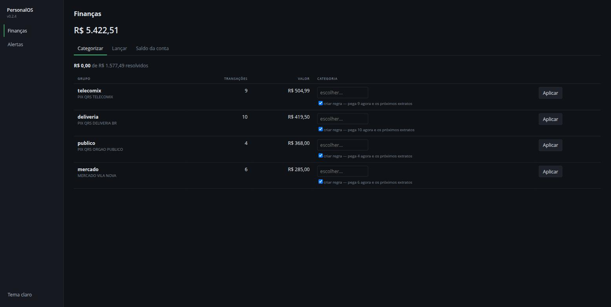

# fAInance

**Sistema financeiro pessoal, local e determinístico.** Lê os extratos do seu
banco, aprende os gastos fixos sozinho e responde perguntas de decisão — sem que
nenhum dado saia da sua máquina e sem que nenhum número venha de um modelo de
linguagem.



> A tela acima resolve o problema que mata sistema financeiro pessoal: depois de
> importar um ano de extrato, tudo nasce sem categoria. Em vez de pedir 200
> cliques, o sistema agrupa as transações, ordena os grupos **pelo dinheiro que
> representam** e ensina uma regra a cada escolha — meia dúzia de decisões cobre
> a maior parte do valor.

## Por que ele existe

Aplicativo de banco mostra o que você gastou. O que ninguém responde é o que
importa: *quanto custa existir por mês, onde cortaria mais, e se dá pra comprar
isso parcelado.* Este projeto responde essas três, com números rastreáveis até a
função que os produziu.

## O que ele faz

- **Importa extrato** em OFX, CSV, XLSX e **PDF**, com reconciliação contra os
  saldos declarados no próprio documento — se a soma não bater, o arquivo é
  recusado em vez de entrar errado.
- **Aprende gastos fixos** do histórico: agrupa por descrição normalizada, exige
  presença em ≥3 meses e valor estável. Zero LLM nos números.
- **Detecta anomalia** por z-score modificado (mediana + MAD, Iglewicz-Hoaglin),
  porque média e desvio padrão são contaminados justamente pelo mês que se quer
  detectar.
- **Responde perguntas de decisão**: custo básico, onde cortar (ranqueado pelo
  impacto anual), projeção do mês, e o juro real embutido num parcelamento.
- **Interface web local** em React, com atualização otimista e desfazer.

## Decisões que valem mais que o código

As caras de reverter estão em [`docs/adr/`](docs/adr/), cada uma com contexto,
justificativa e **gatilho de revisão**. Algumas:

| ADR | Decisão |
|---|---|
| [0001](docs/adr/0001-sqlite-como-banco-unico.md) | SQLite como banco único |
| [0002](docs/adr/0002-llm-nunca-calcula.md) | **O LLM nunca calcula** — todo número vem de SQL ou função pura |
| [0004](docs/adr/0004-convencao-de-sinal-nas-views.md) | Convenção de sinal única nas views |
| [0006](docs/adr/0006-composition-root-fora-do-kernel.md) | Composition root fora do kernel |
| [0007](docs/adr/0007-painel-sem-javascript.md) | Painel sem JavaScript — e por que foi substituída depois |

O desenho completo está em [`docs/specs/`](docs/specs/).

## Arquitetura em uma tela

Kernel modular (`nucleo/`) que **não conhece módulo nenhum**, e módulos em Clean
Architecture (`dominio/` · `aplicacao/` · `infra/`). Há teste que quebra o build
se a camada web citar um módulo pelo nome — a fronteira é mecanizada, não
combinada.

A CLI e a interface web chamam **as mesmas funções** de `aplicacao/`: um teste de
paridade falha no dia em que um endpoint reimplementar regra de negócio.

## Rodar

```bash
uv venv .venv && uv pip install --python .venv/bin/python -e .
.venv/bin/personalos servir        # painel e API em http://127.0.0.1:8000
```

Bind fora de loopback é **recusado sem escape hatch**: não há autenticação, e
expor publicaria dados financeiros na rede.

```bash
.venv/bin/pytest          # 287 testes
cd web && npm test        # lógica pura do front
```

## Uso


```bash
cd ~/lab/personalos
uv venv .venv && uv pip install --python .venv/bin/python -e .   # setup

# módulo financeiro
.venv/bin/personalos financas regra uber Transporte
.venv/bin/personalos financas importar
.venv/bin/personalos financas saldo
.venv/bin/personalos financas gastos --mes 6 --ano 2026
.venv/bin/personalos financas categorias --mes 6
.venv/bin/personalos financas conta nubank "1.000,00"   # saldo inicial da conta
.venv/bin/personalos financas fluxo                      # entradas/saídas por mês
.venv/bin/personalos financas lancar "cafe" 7,00         # lançamento manual (dinheiro/PIX)
.venv/bin/personalos financas inspecionar-pdf extrato.pdf   # layout do PDF, mascarado
.venv/bin/personalos financas sugerir-regras            # onde está o dinheiro sem categoria
.venv/bin/personalos financas recategorizar            # aplica as regras ao que já está gravado

# perguntas de decisão (determinísticas, sem LLM)
.venv/bin/personalos financas custo-basico              # fixos + mediana do variável
.venv/bin/personalos financas onde-cortar --limite 5    # ranqueado por impacto ANUAL
.venv/bin/personalos financas pode-comprar 4500 --parcelas 10 --parcela 500
.venv/bin/personalos financas projecao                  # como o mês deve fechar

# gastos fixos aprendidos e alertas
.venv/bin/personalos financas fixos                      # detecta e lista os fixos
.venv/bin/personalos financas esquecer-fixo "deliveria pedido"  # tira um falso positivo
.venv/bin/personalos insights gerar
.venv/bin/personalos insights listar
.venv/bin/personalos insights dispensar 3                # não volta a aparecer
.venv/bin/personalos memoria listar --tipo gasto_fixo

# painel + API em http://127.0.0.1:8000 (só loopback)
.venv/bin/personalos servir

# backup (já plugado na rotina noturna — ver Backup)
.venv/bin/personalos backup
```

## Abrir sem terminal

```bash
./setup/instalar.sh
```

Instala um serviço **de usuário** (nunca do sistema, nunca root) que sobe o
PersonalOS no login, e um atalho no menu de aplicativos que abre
`http://127.0.0.1:8000/app/`.

O serviço roda com sandbox do systemd: disco somente leitura, com escrita
liberada apenas em `~/.local/share/personalos`, sem escalada de privilégio. O
bind continua travado em loopback pelo próprio programa.

Diagnóstico quando algo falhar:

```bash
systemctl --user status personalos
journalctl --user -u personalos -n 50
```

Desfazer:

```bash
systemctl --user disable --now personalos
rm ~/.config/systemd/user/personalos.service ~/.local/share/applications/personalos.desktop
```

`personalos servir` continua funcionando no terminal — é o caminho de
recuperação quando a interface estiver quebrada.

## Painel e API

`personalos servir` sobe painel e API JSON no mesmo processo, em `127.0.0.1:8000`.
Bind fora de loopback é **recusado sem escape hatch**: não há autenticação, e expor
publicaria seus dados financeiros na rede.

`/docs` traz a API navegável. O painel não conhece módulo nenhum — os cards vêm do
campo `card` do manifesto, e há teste de arquitetura que falha o build se o nome de
um módulo aparecer em `painel/`. Sem JavaScript: gráfico em SVG do servidor e
formulário HTML puro (ADR 0007).

## Categorizar sem morrer de tédio

Depois de importar um ano de extrato, tudo nasce sem categoria — e sem categoria o
`onde-cortar` só vê os gastos fixos. `financas sugerir-regras` agrupa as transações
sem categoria pela mesma normalização que a detecção de gasto fixo usa e ordena
pelo **valor** que cada grupo representa, não pela contagem: meia dúzia de regras
cobre a maior parte do dinheiro.

O padrão sugerido é a palavra mais longa comum a todas as descrições do grupo
(entre "PIX", "QRS" e "TELECOMIX", a última é a que identifica). Empate resolve por
ordem alfabética — `max()` sobre conjunto não é determinístico, e sugestão que muda
entre execuções é pior que nenhuma. A coluna de alcance mostra o efeito da regra
**antes** de criá-la.

A categoria é sempre escolha sua; a ferramenta só mostra onde está o volume.

## Extrato em PDF

`financas importar` aceita PDF, com duas guardas contra falha silenciosa — que é o
modo de falhar típico do formato: nenhuma linha com data e valor pode ser ignorada
sem classificação, e a soma extraída é reconciliada contra os saldos declarados no
próprio extrato, casando por data. Se não fechar, o arquivo é recusado.

Linhas de "Saldo do dia" são excluídas: nos extratos reais testados eram ~30% das
linhas candidatas, e importá-las criaria dezenas de transações fantasmas.

`financas inspecionar-pdf` mostra a estrutura de um extrato com tudo **mascarado**
(letra → `a`, dígito → `9`), para calibrar o leitor de um banco novo sem expor
conteúdo. A saída é segura para compartilhar; o único vazamento residual é a
quantidade de dígitos, ou seja a ordem de grandeza dos valores.

## Perguntas de decisão

`custo-basico`, `onde-cortar`, `pode-comprar` e `projecao` são funções puras em
`aplicacao/analise.py` — são as ferramentas que o agente conversacional chama.
O LLM escolhe qual chamar e narra; nenhum número sai dele.

Escolhas de método, por que importam:
- **Mediana, não média**, em todo agregado mensal: um mês atípico não deve virar
  o seu "normal".
- **Mês corrente excluído** das medianas: um mês pela metade puxaria tudo para baixo.
- **`numpy-financial`** para dinheiro parcelado: `rate` recupera o juro embutido em
  "10x de R$ 500" (é assim que se descobre que o "sem juros" tem 1,96%/mês) e `pmt`
  calcula a parcela a partir de uma taxa. Amortização e taxa efetiva à mão erram fácil.
- **Projeção só acelera o gasto variável** pelo ritmo de dias; gasto fixo não se
  multiplica com o calendário, e o que ainda não caiu entra como pendente.
- **Anomalia por z-score modificado** (mediana + MAD, corte 3,5 — Iglewicz-Hoaglin),
  com queda para um limiar relativo quando o MAD é zero. Média e desvio padrão são
  contaminados justamente pelo mês que se quer detectar.
- `pode-comprar` **não dá veredito**: devolve parcela, juro, folga e meses de
  reserva. A decisão é sua.

## Gastos fixos e insights

`financas fixos` aprende do histórico: agrupa as despesas por descrição
normalizada (sem os dígitos onde o banco escreve data e parcela) e aceita como
fixo o que aparece em ≥3 meses, com valor estável (maioria a ±25% da mediana) e
atividade recente. O resultado fica em `nucleo_memoria`, então reaprender
atualiza em vez de duplicar, e uma correção sua sobrevive.

Nada disso usa LLM: todo número vem de SQL/Python.

Regras atuais: gasto fixo que não apareceu no último mês com movimento (e que
para de avisar quando a ausência deixa de ser recente, senão uma assinatura
cancelada incomodaria pra sempre); gasto fixo que subiu mais de 10% da mediana;
categoria fora do normal pelo z-score modificado. Um insight dispensado não volta
(dedup por `regra_id + chave_dedup`).

Um gasto mensal recorrente e mais ou menos estável (delivery, por exemplo) pode
ser classificado como fixo — é o critério funcionando, não um bug. Use
`esquecer-fixo` para removê-lo.

## Backup

`personalos backup` cria uma cópia consistente do banco em
`~/.local/share/personalos/backups/personalos-<timestamp>.db` via API nativa de
backup do SQLite (segura mesmo com o banco em uso).

**Automatizado:** `~/lab/noite/modules/01-backup.sh` chama este comando antes de
disparar o restic, então o snapshot consistente entra no backup do sistema (o
restic sozinho copiaria o arquivo em uso, o que não é seguro com WAL). Mantém os
7 snapshots locais mais recentes; o histórico longo é do restic. Não existe timer
próprio do PersonalOS por design — um agendador já existia.

Restaurar = copiar o arquivo de backup de volta pro caminho do banco (`~/.local/share/personalos/personalos.db`).
Os extratos brutos originais em `extratos/` são a fonte de reimportação idempotente
(dedup por `fit_id`) — guarde-os como disaster recovery adicional.

## Dashboard (Metabase, opcional)

O Metabase é uma ferramenta de visualização opcional — não é obrigatório pro
PersonalOS funcionar. Ele lê as views (`vw_financas_*_v1`) do banco real, em
modo somente leitura.

```bash
docker compose --profile metabase up -d
```

Depois abra `http://localhost:3000`, complete o setup inicial, e adicione uma
conexão de banco de dados apontando pro arquivo montado em `/data/personalos.db`
(tipo SQLite). Isso é feito uma vez só, pela UI — não é automatizado por design
(ferramenta pessoal, uso único).

## Decisões de arquitetura

As decisões caras de reverter estão em [`docs/adr/`](docs/adr/) — cada uma com
contexto, justificativa e **gatilho de revisão**. Comece pelo
[índice](docs/adr/README.md).

## Arquitetura

- `src/personalos/nucleo/` — kernel: config XDG, engine compartilhada (SQLite+WAL),
  transação de escrita (`BEGIN IMMEDIATE`), migrações idempotentes, contrato de módulo
  (`Modulo`, dataclass), memória (`nucleo_memoria`) e motor de insights
  (`nucleo_insights`). **Não importa módulo nenhum** — ver ADR 0006.
- `src/personalos/composicao.py` — composition root: a lista estática de módulos
  plugados. É a única camada que conhece todos eles.
- `src/personalos/modulos/<nome>/` — cada módulo é um pacote independente
  (Clean Architecture: dominio/aplicacao/infra + cli.py + modulo.py de manifesto).
  Tabelas prefixadas por módulo (`financas_*`) evitam colisão de namespace.
- `src/personalos/cli.py` — CLI raiz, agrega os módulos via `add_typer`.

## Gatilhos para revisitar decisões de arquitetura

- **Alembic** ← primeira migração destrutiva de schema desconfortável pro mini-mecanismo em `nucleo/migracoes.py`.
- **Postgres** ← necessidade real de 2º processo escritor concorrente, ou pgvector.
- **EventBus** ← primeiro par publicador/assinante real entre dois módulos distintos.
- **YAML de regras de insight** ← quando as regras determinísticas passarem de ~10 (hoje: 3).
- **API FastAPI + painel** ← gatilho disparado e ENTREGUE (v0.2.2 e v0.2.3): a interface
  escolhida foi um painel web local, então a API ganhou consumidor real. O painel saiu
  sem HTMX e sem JavaScript nenhum — ver ADR 0007.
- **Dashboard SPA (SolidJS)** ← dores documentadas de verdade com o painel atual, não antecipação.

## Testes

`.venv/bin/pytest`
