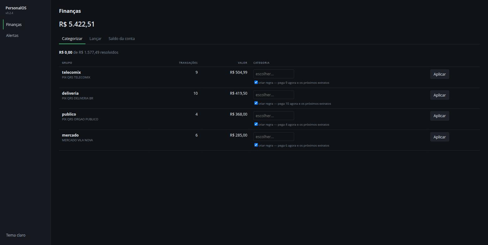

[🇺🇸 English](README.md) · 🇧🇷 Português

# fAInance

**Sistema financeiro pessoal, local e determinístico.** Lê os extratos do seu banco, aprende os gastos
fixos sozinho e responde perguntas de decisão — sem que nenhum dado saia da sua máquina e sem que nenhum
número venha de um modelo de linguagem.

[](LICENSE)
[](pyproject.toml)
[](tests/)



> A tela acima resolve o problema que mata sistema financeiro pessoal: depois de importar um ano de
> extrato, tudo nasce sem categoria. Em vez de pedir 200 cliques, o sistema agrupa as transações, ordena
> os grupos **pelo dinheiro que representam** e ensina uma regra a cada escolha — meia dúzia de decisões
> cobre a maior parte do valor.

O pacote Python e a CLI se chamam **`personalos`** (PersonalOS): o fAInance é o módulo financeiro dele,
construído sobre um kernel modular pequeno. Autor: **Yago Macambira**.

## 💡 Por que ele existe

Aplicativo de banco mostra o que você gastou. O que ninguém responde é o que importa: *quanto custa
existir por mês, onde cortaria mais, e se dá pra comprar isso parcelado.* Este projeto responde essas
três, com números rastreáveis até a função que os produziu.

## ✨ O que ele faz

- **Importa extrato** em OFX, CSV, XLSX e **PDF**, com reconciliação contra os saldos declarados no
  próprio documento — se a soma não bater, o arquivo é recusado em vez de entrar errado.
- **Aprende gastos fixos** do histórico: agrupa por descrição normalizada, exige presença em ≥3 meses e
  valor estável. Zero LLM nos números.
- **Detecta anomalia** por z-score modificado (mediana + MAD, Iglewicz-Hoaglin), porque média e desvio
  padrão são contaminados justamente pelo mês que se quer detectar.
- **Responde perguntas de decisão**: custo básico, onde cortar (ranqueado pelo impacto anual), projeção do
  mês, e o juro real embutido num parcelamento.
- **Interface web local** em React, com atualização otimista e desfazer.
- **Sugere categoria a partir do próprio histórico** — e só quando há precedente, com a palavra que casou
  visível. Sem precedente, não sugere: campo vazio é melhor que palpite.
- **Simula a compra parcelada** e mostra o juro que o "sem juros" esconde.

## 🚀 Início rápido

Requisitos: Python ≥ 3.12 e [uv](https://docs.astral.sh/uv/). Node.js só se for mexer na interface web
(a SPA já compilada está versionada em `src/personalos/web_dist/`).

```bash
git clone https://github.com/y4g0o/fAInance.git
cd fAInance
uv venv .venv && uv pip install --python .venv/bin/python -e .
.venv/bin/personalos servir        # interface e API em http://127.0.0.1:8000/app/
```

Bind fora de loopback é **recusado sem escape hatch**: não há autenticação, e expor publicaria dados
financeiros na rede.

Primeiros passos com os seus dados:

```bash
cp ~/Downloads/extrato.ofx extratos/               # extratos/ é ignorada pelo git
.venv/bin/personalos financas importar             # importa todos os CSV/OFX/QFX/XLSX/PDF de extratos/
.venv/bin/personalos financas sugerir-regras       # onde está o dinheiro sem categoria
.venv/bin/personalos financas custo-basico         # fixos + mediana do variável
```

Testes:

```bash
uv pip install --python .venv/bin/python -e ".[dev]"
.venv/bin/pytest          # back-end
cd web && npm ci && npm test        # lógica pura do front (vitest)
cd web && npm run e2e     # fluxo principal no navegador (Playwright)
```

## 🧭 Como funciona

- **Kernel modular** (`src/personalos/nucleo/`) que **não conhece módulo nenhum**, e módulos em Clean
  Architecture (`dominio/` · `aplicacao/` · `infra/`). Há teste que quebra o build se a camada web citar um
  módulo pelo nome — a fronteira é mecanizada, não combinada.
- A **CLI e a interface web chamam as mesmas funções** de `aplicacao/`: um teste de paridade
  (`tests/test_api_escrita.py`) falha no dia em que um endpoint reimplementar regra de negócio.
- **Todo número vem de SQL ou de função pura** ([ADR 0002](docs/adr/0002-llm-nunca-calcula.md)). O
  contrato de conversa (`nucleo/portas/chat.py`) é feito para que os números e as ferramentas que os
  produziram sejam preenchidos pelo código, nunca por LLM.
- **SQLite** é o banco único ([ADR 0001](docs/adr/0001-sqlite-como-banco-unico.md)), com WAL e transações
  de escrita abertas com `BEGIN IMMEDIATE` (`nucleo/transacao.py`).

Estrutura:

- `src/personalos/nucleo/` — kernel: config XDG, engine compartilhada (SQLite+WAL), transação de escrita
  (`BEGIN IMMEDIATE`), migrações idempotentes, contrato de módulo (`Modulo`, dataclass), memória
  (`nucleo_memoria`) e motor de insights (`nucleo_insights`). **Não importa módulo nenhum** — ver ADR 0006.
- `src/personalos/composicao.py` — composition root: a lista estática de módulos plugados. É a única camada
  que conhece todos eles.
- `src/personalos/modulos/<nome>/` — cada módulo é um pacote independente (Clean Architecture:
  dominio/aplicacao/infra + `cli.py` + `modulo.py` de manifesto). Tabelas prefixadas por módulo
  (`financas_*`) evitam colisão de namespace.
- `src/personalos/api/` — app FastAPI; `src/personalos/painel/` — o painel Jinja original;
  `web/` — a SPA em React + Vite + TypeScript, compilada para `src/personalos/web_dist/`.
- `src/personalos/cli.py` — CLI raiz, agrega os módulos via `add_typer`.

### Decisões que valem mais que o código

As caras de reverter estão em [`docs/adr/`](docs/adr/), cada uma com contexto, justificativa e **gatilho
de revisão**. Comece pelo [índice](docs/adr/README.md). Algumas:

| ADR | Decisão |
|---|---|
| [0001](docs/adr/0001-sqlite-como-banco-unico.md) | SQLite como banco único |
| [0002](docs/adr/0002-llm-nunca-calcula.md) | **O LLM nunca calcula** — todo número vem de SQL ou função pura |
| [0004](docs/adr/0004-convencao-de-sinal-nas-views.md) | Convenção de sinal única nas views |
| [0006](docs/adr/0006-composition-root-fora-do-kernel.md) | Composition root fora do kernel |
| [0007](docs/adr/0007-painel-sem-javascript.md) | Painel sem JavaScript — e por que foi substituída depois ([0008](docs/adr/0008-spa-react-substitui-painel-sem-js.md)) |
| [0010](docs/adr/0010-superficie-de-ataque-do-painel-local.md) | **Superfície de ataque de um painel local sem senha** — inclui uma falha explorável encontrada e corrigida |

### Gatilhos para revisitar decisões de arquitetura

- **Alembic** ← primeira migração destrutiva de schema desconfortável pro mini-mecanismo em `nucleo/migracoes.py`.
- **Postgres** ← necessidade real de 2º processo escritor concorrente, ou pgvector.
- **EventBus** ← primeiro par publicador/assinante real entre dois módulos distintos.
- **YAML de regras de insight** ← quando as regras determinísticas passarem de ~10 (hoje: 3).
- **API FastAPI + painel** ← gatilho disparado e ENTREGUE (v0.2.2 e v0.2.3): a interface escolhida foi um
  painel web local, então a API ganhou consumidor real. O painel saiu primeiro sem HTMX e sem JavaScript
  nenhum (ADR 0007), depois substituído pela SPA React (ADR 0008).

## 📖 Uso em detalhe

<details>
<summary><strong>Todos os comandos da CLI</strong></summary>

```bash
# módulo financeiro
.venv/bin/personalos financas regra uber Transporte
.venv/bin/personalos financas importar
.venv/bin/personalos financas saldo
.venv/bin/personalos financas gastos --mes 6 --ano 2026
.venv/bin/personalos financas categorias --mes 6
.venv/bin/personalos financas conta nubank "1.000,00"   # saldo inicial da conta
.venv/bin/personalos financas fluxo                      # entradas/saídas por mês
.venv/bin/personalos financas lancar "cafe" 7,00         # lançamento manual (dinheiro/PIX)
.venv/bin/personalos financas inspecionar-pdf extrato.pdf   # layout do PDF, mascarado
.venv/bin/personalos financas sugerir-regras            # onde está o dinheiro sem categoria
.venv/bin/personalos financas recategorizar            # aplica as regras ao que já está gravado

# perguntas de decisão (determinísticas, sem LLM)
.venv/bin/personalos financas custo-basico              # fixos + mediana do variável
.venv/bin/personalos financas onde-cortar --limite 5    # ranqueado por impacto ANUAL
.venv/bin/personalos financas pode-comprar 4500 --parcelas 10 --parcela 500
.venv/bin/personalos financas projecao                  # como o mês deve fechar

# gastos fixos aprendidos e alertas
.venv/bin/personalos financas fixos                      # detecta e lista os fixos
.venv/bin/personalos financas esquecer-fixo "deliveria pedido"  # tira um falso positivo
.venv/bin/personalos insights gerar
.venv/bin/personalos insights listar
.venv/bin/personalos insights dispensar 3                # não volta a aparecer
.venv/bin/personalos memoria listar --tipo gasto_fixo

# interface + API em http://127.0.0.1:8000 (só loopback)
.venv/bin/personalos servir

# backup
.venv/bin/personalos backup
```

</details>

<details>
<summary><strong>Interface web e API</strong></summary>

`personalos servir` sobe interface e API JSON no mesmo processo, em `127.0.0.1:8000`.
Bind fora de loopback é **recusado sem escape hatch**.

- `/app/` — a SPA React (importar extrato, corrigir saldo, lançar à mão, categorizar em lote, análise,
  simulador de compra). Ver [ADR 0008](docs/adr/0008-spa-react-substitui-painel-sem-js.md).
- `/` — o painel Jinja original, com gráfico SVG gerado no servidor e formulário HTML puro
  ([ADR 0007](docs/adr/0007-painel-sem-javascript.md)); continua no ar durante a transição para a SPA.
- `/docs` — API navegável.

Nenhuma das interfaces conhece módulo pelo nome: os cards do painel vêm do campo `card` do manifesto, e há
testes de arquitetura que falham o build se o nome de um módulo aparecer em `painel/` ou em `web/src/shell/`.
Escrita via HTTP exige `Host` de loopback e `Origin` correspondente
([ADR 0009](docs/adr/0009-escrita-http-e-verificacao-de-origem.md),
[ADR 0010](docs/adr/0010-superficie-de-ataque-do-painel-local.md)).

</details>

<details>
<summary><strong>Abrir sem terminal (serviço de usuário do systemd)</strong></summary>

```bash
./setup/instalar.sh
```

Instala um serviço **de usuário** (nunca do sistema, nunca root) que sobe o PersonalOS no login, e um atalho
no menu de aplicativos que abre `http://127.0.0.1:8000/app/`.

O serviço roda com sandbox do systemd: disco somente leitura, com escrita liberada apenas em
`~/.local/share/personalos`, sem escalada de privilégio. O bind continua travado em loopback pelo próprio programa.

Diagnóstico quando algo falhar:

```bash
systemctl --user status personalos
journalctl --user -u personalos -n 50
```

Desfazer:

```bash
systemctl --user disable --now personalos
rm ~/.config/systemd/user/personalos.service ~/.local/share/applications/personalos.desktop
```

`personalos servir` continua funcionando no terminal — é o caminho de recuperação quando a interface estiver quebrada.

</details>

<details>
<summary><strong>Categorizar sem morrer de tédio</strong></summary>

Depois de importar um ano de extrato, tudo nasce sem categoria — e sem categoria o `onde-cortar` só vê os
gastos fixos. `financas sugerir-regras` agrupa as transações sem categoria pela mesma normalização que a
detecção de gasto fixo usa e ordena pelo **valor** que cada grupo representa, não pela contagem: meia dúzia
de regras cobre a maior parte do dinheiro.

O padrão sugerido é a palavra mais longa comum a todas as descrições do grupo (entre "PIX", "QRS" e
"TELECOMIX", a última é a que identifica). Empate resolve por ordem alfabética — `max()` sobre conjunto não
é determinístico, e sugestão que muda entre execuções é pior que nenhuma. A coluna de alcance mostra o
efeito da regra **antes** de criá-la.

A categoria é sempre escolha sua; a ferramenta só mostra onde está o volume.

</details>

<details>
<summary><strong>Extrato em PDF</strong></summary>

`financas importar` aceita PDF, com duas guardas contra falha silenciosa — que é o modo de falhar típico do
formato: nenhuma linha com data e valor pode ser ignorada sem classificação, e a soma extraída é reconciliada
contra os saldos declarados no próprio extrato, casando por data. Se não fechar, o arquivo é recusado.

Linhas de "Saldo do dia" são excluídas: nos extratos reais testados eram ~30% das linhas candidatas, e
importá-las criaria dezenas de transações fantasmas.

`financas inspecionar-pdf` mostra a estrutura de um extrato com tudo **mascarado** (letra → `a`,
dígito → `9`), para calibrar o leitor de um banco novo sem expor conteúdo. A saída é segura para
compartilhar; o único vazamento residual é a quantidade de dígitos, ou seja a ordem de grandeza dos valores.

</details>

<details>
<summary><strong>Perguntas de decisão e escolhas de método</strong></summary>

`custo-basico`, `onde-cortar`, `pode-comprar` e `projecao` são funções puras em `aplicacao/analise.py` — são
as ferramentas que um agente conversacional deve chamar. O LLM escolheria qual chamar e narraria; nenhum
número sai dele.

Escolhas de método, por que importam:
- **Mediana, não média**, em todo agregado mensal: um mês atípico não deve virar o seu "normal".
- **Mês corrente excluído** das medianas: um mês pela metade puxaria tudo para baixo.
- **`numpy-financial`** para dinheiro parcelado: `rate` recupera o juro embutido em "10x de R$ 500" (é assim
  que se descobre que o "sem juros" tem 1,96%/mês) e `pmt` calcula a parcela a partir de uma taxa.
  Amortização e taxa efetiva à mão erram fácil.
- **Projeção só acelera o gasto variável** pelo ritmo de dias; gasto fixo não se multiplica com o
  calendário, e o que ainda não caiu entra como pendente.
- **Anomalia por z-score modificado** (mediana + MAD, corte 3,5 — Iglewicz-Hoaglin), com queda para um
  limiar relativo quando o MAD é zero. Média e desvio padrão são contaminados justamente pelo mês que se
  quer detectar.
- `pode-comprar` **não dá veredito**: devolve parcela, juro, folga e meses de reserva. A decisão é sua.

</details>

<details>
<summary><strong>Gastos fixos e insights</strong></summary>

`financas fixos` aprende do histórico: agrupa as despesas por descrição normalizada (sem os dígitos onde o
banco escreve data e parcela) e aceita como fixo o que aparece em ≥3 meses, com valor estável (maioria a
±25% da mediana) e atividade recente. O resultado fica em `nucleo_memoria`, então reaprender atualiza em vez
de duplicar, e uma correção sua sobrevive.

Nada disso usa LLM: todo número vem de SQL/Python.

Regras atuais: gasto fixo que não apareceu no último mês com movimento (e que para de avisar quando a
ausência deixa de ser recente, senão uma assinatura cancelada incomodaria pra sempre); gasto fixo que subiu
mais de 10% da mediana; categoria fora do normal pelo z-score modificado. Um insight dispensado não volta
(dedup por `regra_id + chave_dedup`).

Um gasto mensal recorrente e mais ou menos estável (delivery, por exemplo) pode ser classificado como fixo —
é o critério funcionando, não um bug. Use `esquecer-fixo` para removê-lo.

</details>

<details>
<summary><strong>Backup</strong></summary>

`personalos backup` cria uma cópia consistente do banco em
`~/.local/share/personalos/backups/personalos-<timestamp>.db` via API nativa de backup do SQLite (segura
mesmo com o banco em uso).

Não existe timer próprio do PersonalOS por design — chame o comando pelo agendador que você já tem. Na
máquina do autor, um script noturno roda `personalos backup` antes do restic, então o snapshot consistente
entra no backup do sistema (o restic sozinho copiaria o arquivo em uso, o que não é seguro com WAL); ele
mantém os 7 snapshots locais mais recentes, e o histórico longo é do restic.

Restaurar = copiar o arquivo de backup de volta pro caminho do banco (`~/.local/share/personalos/personalos.db`).
Os extratos brutos originais em `extratos/` são a fonte de reimportação idempotente (dedup por `fit_id`) —
guarde-os como disaster recovery adicional.

</details>

<details>
<summary><strong>Dashboard com Metabase (opcional)</strong></summary>

O Metabase é uma ferramenta de visualização opcional — não é obrigatório pro PersonalOS funcionar. Ele lê as
views (`vw_financas_*_v1`) do banco real, em modo somente leitura.

```bash
docker compose --profile metabase up -d
```

Depois abra `http://localhost:3000` (publicado só em loopback), complete o setup inicial, e adicione uma
conexão de banco de dados apontando pro arquivo montado em `/data/personalos.db` (tipo SQLite). Isso é feito
uma vez só, pela UI — não é automatizado por design (ferramenta pessoal, uso único).

</details>

## 📌 Estado do projeto e limitações

- Versão **0.2.4**, de um usuário, mantida por uma pessoa; só Linux tem instalador (`setup/` usa unidades
  de usuário do systemd).
- **Sem autenticação por design**: só aceita bind em loopback. Leia o
  [ADR 0010](docs/adr/0010-superficie-de-ataque-do-painel-local.md) antes de mudar qualquer coisa de rede.
- **A conversa em linguagem natural ainda não existe**: o contrato (`nucleo/portas/chat.py`) e o
  `POST /api/chat` existem, mas `personalos servir` sobe sem serviço de chat, e o endpoint responde
  `501 Not Implemented`.
- A cobertura de bancos se limita ao que foi testado: os mapeamentos de cabeçalho CSV ficam em
  `modulos/financas/infra/leitores/csv_.py`; o layout de PDF muda por banco, e um banco novo deve ser
  calibrado antes com `inspecionar-pdf`.
- Um gasto variável recorrente e estável (ex.: delivery) pode ser detectado como fixo — use `esquecer-fixo`.
- Duas interfaces convivem durante a transição (`/` Jinja, `/app/` SPA), e o `node_modules` é a única parte
  do sistema que exige manutenção contínua (custo aceito no ADR 0008).

## 🗺️ Roadmap

1. **Aposentar o painel Jinja** e servir a SPA na raiz, como previsto no ADR 0008 (a SPA usa
   `base: '/app/'` só enquanto o painel ocupa `/`).
2. **Consultor conversacional** implementando `ServicoChat` sobre a API HTTP do Ollama local, chamando as
   funções determinísticas de `aplicacao/analise.py` — sem framework de agente (ADR 0002, ADR 0003).
3. **Mais layouts de banco**: novos mapeamentos CSV e calibração de PDF via `inspecionar-pdf`.
4. **Mais regras determinísticas de insight** (hoje são 3); levá-las para YAML quando passarem de ~10,
   conforme o gatilho acima.
5. **Adotar `ruff format`** no código todo (o `ruff check` já passa; a formatação ainda não foi aplicada à
   maioria dos arquivos).

## 🤝 Como contribuir

Issues e PRs são bem-vindos — principalmente testes, formatos de banco, documentação e acabamento da interface.
Veja o [CONTRIBUTING.md](CONTRIBUTING.md) para configuração, convenções e uma lista de boas primeiras tarefas.

## 📄 Licença

MIT — ver [`LICENSE`](LICENSE).
